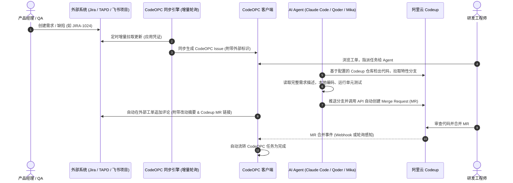
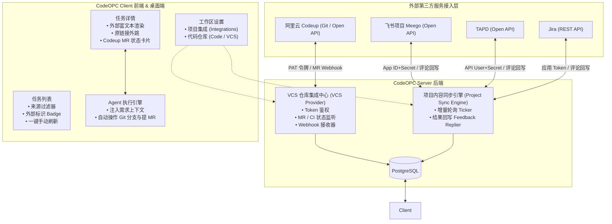

# CodeOPC 外部集成设计方案：项目管理（Jira / TAPD / 飞书项目）与代码管理（阿里云 Codeup）

## 一、 背景与核心设计原则

在企业软件研发生态中，团队通常已经在现有的项目管理系统（Jira、TAPD、飞书项目）中维护需求、缺陷与迭代，并在 Git 代码托管平台（如阿里云 Codeup）中管理源码和代码评审（Code Review / MR）。

CodeOPC 的定位是 **“AI Agent 协作执行工作台”**，而不是替代现有工具的全功能项目管理软件。为了最大化发挥 Agent 的编程交付价值并保持系统的轻量与易用，本方案遵循以下核心设计原则：

1. **应用级接入（App-level Integration）**：
   - 以企业应用/服务账号（Service Token / App Bot）的方式接入，每个工作区（Workspace）只需管理员配置一次全局凭证。
   - 避免每位成员单独进行 OAuth 授权绑定的高摩擦体验。
2. **免权限判定（No RBAC Overhead）**：
   - 不在 CodeOPC 中复制或映射外部系统的细粒度权限列表（ACL）和审批流。
   - 只要任务同步进入工作区，工作区内的团队成员和 Agent 均可查看、领取并开展编码协作。
3. **内容完整同步（Content Synchronization）**：
   - 原汁原味同步需求标题、富文本/Markdown 描述、图片附件、外部状态和优先级。
4. **端到端交付闭环（Closed-Loop Delivery）**：
   - **外部派单 → CodeOPC 同步内容 → Agent 检出 Codeup 仓库编码自测 → 自动提交并创建 Codeup MR → 自动将改动摘要与 MR 链接回写至原系统工单**。

---

## 二、 业务闭环与整体架构

### 2.1 端到端协同流程



### 2.2 系统分层架构



---

## 三、 项目管理接入：Jira / TAPD / 飞书项目

### 3.1 接入配置（工作区设置 -> 项目集成）
管理员在 `工作区设置` -> `项目集成` 中添加对应平台，填写应用凭证：

| 集成平台 | 接入凭证与参数 | 说明 |
| :--- | :--- | :--- |
| **Jira** | • 实例地址 (`https://jira.corp.com`)<br>• 服务账号邮箱 (Email)<br>• API Token / Personal Access Token<br>• 目标项目 Key (如 `TRADE`) | 支持 Jira Cloud 和 Jira Data Center / Server 私有化部署版本。 |
| **TAPD** | • TAPD 公司 ID (`company_id`)<br>• API User (`api_user`)<br>• API Secret (`api_password`)<br>• 目标项目 ID (`project_id`) | 基于 TAPD 官方开放平台认证规范。 |
| **飞书项目 (Meego)** | • 企业自建应用 App ID (`app_id`)<br>• 企业自建应用 App Secret (`app_secret`)<br>• 飞书项目 Key (`project_key`) | 调用飞书项目 OpenAPI（工作项拉取与评论写入）。 |

### 3.2 同步机制与策略
1. **增量轮询（Polling）为主**：
   - 后台定时器每隔固定周期（默认 3~5 分钟，可配置）调用外部平台接口：
     - 查询条件：`updated_at >= last_sync_time`
   - **核心优势**：零公网暴露门槛，即使在公司内网、本地 Docker、离线办公网中也能稳定工作。
2. **手动强制同步**：
   - 列表页与详情页提供「立即同步」按钮，方便刚建单的用户立刻拉取最新状态。
3. **内容解析映射**：
   - **标题与描述**：Markdown/富文本完整同步，外部图片与附件下载/转存至本地或对象存储。
   - **基础属性**：外部状态（如 `In Progress`）、优先级（`High`）、外部作者作为只读属性保存并展示。
4. **结果回写（Feedback Push）**：
   - Agent 产出交付物（如 Commit、Codeup MR 链接、代码自测结论）时，通过配置的应用身份在外部工单发表结构化评论。

### 3.3 客户端 UI/UX 改造
- **任务列表（Issues List）**：
  - 增加来源下拉筛选器：`全部` / `本地` / `Jira [项目名]` / `TAPD [项目名]` / `飞书 [项目名]`。
  - 列表项标题前增加来源 Badge（例如：`[Jira] PROJ-102`、`[飞书] #8848`），点击编号右侧小图标直接在系统默认浏览器中打开外部工单。
- **任务详情（Issue Detail）**：
  - 顶部外链条：展示来源系统、外部原状态、外部创建时间、外部跳转链接。
  - 主内容区：使用现有编辑器渲染同步过来的完整富文本描述与图片。
  - 底部回写卡片：支持勾选“任务完成时回写评论”。

---

## 四、 源代码管理接入：阿里云 Codeup

CodeOPC 服务端与前端已具备统一的 VCS（版本控制系统）抽象层（支持 GitLab、Forgejo、Gitea、GitHub）。接入 **阿里云 Codeup** 将自然扩展该架构。

### 4.1 接入配置（工作区设置 -> 代码仓库）
在 `packages/views/settings/components/code-vcs.tsx` 的提供商下拉列表中增加 **「阿里云 Codeup」**：
- **实例地址**：默认为 `https://codeup.aliyun.com`（支持企业专属二级域名或混合云独立域名）。
- **认证凭证**：填写 Codeup **个人访问令牌（PAT）** 或 **企业访问令牌**（授权范围：`repo` 代码库只读/写入、`pull_request` 合并请求只读/写入）。
- **Webhook 回调**：CodeOPC 生成唯一的 Webhook 地址与 Secret Token，可配置在 Codeup 仓库的 Webhook 设置中。

### 4.2 核心能力与适配
1. **仓库关联与检出**：
   - 工作区可绑定一个或多个 Codeup 代码仓库。
   - Agent 接收任务时，根据关联仓库配置，以 Token 凭证拉取代码、切换分支。
2. **Merge Request (MR) 自动创建**：
   - Agent 执行完毕后，调用 Codeup Open API（`POST /api/v4/projects/{id}/merge_requests`）自动创建 MR，填充 MR 标题、改动说明及关联 Issue 编号。
3. **MR 状态追踪与自动关单**：
   - 接收 Codeup Webhook（或定时轮询）：
     - 当 MR 处于评审中时，Issue 显示 `In Review` 并展示 MR 状态卡片。
     - 当 MR 在 Codeup 中被点击“合入（Merged）”时，CodeOPC 自动将 Issue 标记为 `Done`。
4. **CI 流水线状态镜像**：
   - 同步呈现 Codeup Flow 流水线运行状态（`Pending` / `Running` / `Passed` / `Failed`）。

---

## 五、 数据模型与数据库设计 (Schema)

### 5.1 数据表设计

#### 1. `project_integrations` (外部项目管理接入配置表)
```sql
CREATE TABLE project_integrations (
    id UUID PRIMARY KEY DEFAULT gen_random_uuid(),
    workspace_id UUID NOT NULL REFERENCES workspace(id),
    provider VARCHAR(32) NOT NULL, -- 'jira' | 'tapd' | 'feishu'
    name VARCHAR(128) NOT NULL,
    base_url TEXT NOT NULL,
    credentials_encrypted JSONB NOT NULL, -- 存放加密的 token/secret/user
    target_project_key VARCHAR(128) NOT NULL, -- 项目唯一标识
    sync_interval_seconds INT NOT NULL DEFAULT 300,
    last_synced_at TIMESTAMPTZ,
    status VARCHAR(32) NOT NULL DEFAULT 'active',
    created_at TIMESTAMPTZ NOT NULL DEFAULT NOW(),
    updated_at TIMESTAMPTZ NOT NULL DEFAULT NOW()
);
CREATE INDEX idx_project_integrations_ws ON project_integrations(workspace_id);
```

#### 2. `issue` 表扩展字段
```sql
ALTER TABLE issue 
    ADD COLUMN external_source VARCHAR(32) DEFAULT NULL, -- 'jira' | 'tapd' | 'feishu'
    ADD COLUMN external_id VARCHAR(128) DEFAULT NULL,    -- 外部唯一主键，如 'PROJ-102'
    ADD COLUMN external_url TEXT DEFAULT NULL,           -- 原网页链接
    ADD COLUMN external_status VARCHAR(64) DEFAULT NULL, -- 外部原始状态名称
    ADD COLUMN external_raw JSONB DEFAULT NULL;          -- 原始扩展属性

CREATE INDEX idx_issue_external_lookup ON issue(workspace_id, external_source, external_id);
```

#### 3. `vcs_connection` (扩展支持 Codeup)
现有 `vcs_connection.provider` 枚举扩展支持 `'codeup'`，无需修改表结构。

---

## 六、 详细实施计划与任务拆解

| 模块 | 任务项 | 涉及文件/路径 | 预估工时 |
| :--- | :--- | :--- | :--- |
| **1. Codeup 源码接入** | • 后端实现 `vcs.Provider` 接口 (`codeup.go`)<br>• 实现 Token 校验与 MR Webhook 解析<br>• 前端 `code-vcs.tsx` 增加 Codeup 选项与图标 | `server/internal/integrations/vcs/codeup.go`<br>`packages/views/settings/components/code-vcs.tsx` | 2~3 天 |
| **2. 项目管理应用接入** | • 新增 `project_integrations` 数据表与配置 API<br>• 后端实现 Jira / TAPD / 飞书项目 REST 客户端<br>• 实现增量轮询同步调度器 (Ticker) | `server/internal/integrations/projectmanagement/`<br>`server/internal/handler/project_integrations.go` | 4~5 天 |
| **3. 客户端界面升级** | • 工作区设置增加「项目集成」Tab<br>• Issue 列表增加来源过滤下拉与平台 Badge<br>• Issue 详情增加外部工单属性与 Codeup MR 关联卡片 | `packages/views/settings/components/`<br>`packages/views/issues/components/`<br>`packages/core/types/issue.ts` | 3~4 天 |
| **4. Agent 协同与自动回写** | • Agent Prompt 自动注入外部需求上下文<br>• Agent 任务结束时自动调用 Codeup 提 MR<br>• 自动调用外部系统 API 回写评论与链接 | `server/pkg/agent/`<br>`packages/core/` | 2~3 天 |

---

## 七、 总结

通过采用 **“应用级接入 + 增量内容同步 + 无权限负担 + 阿里云 Codeup 源码闭环”** 的设计：
1. **轻量简单**：免除复杂的 OAuth 换票与全员权限同步逻辑，开发量降低 70% 以上；
2. **研发顺畅**：团队无需改变在 Jira/TAPD/飞书项目中的报单习惯，而在 CodeOPC 内部即可让 Agent 自动拉取代码、编写测试、提交 Codeup MR 并回写进度；
3. **企业合规**：企业仅需分配只读+评论的应用 Token，安全审批摩擦力降至最低。
