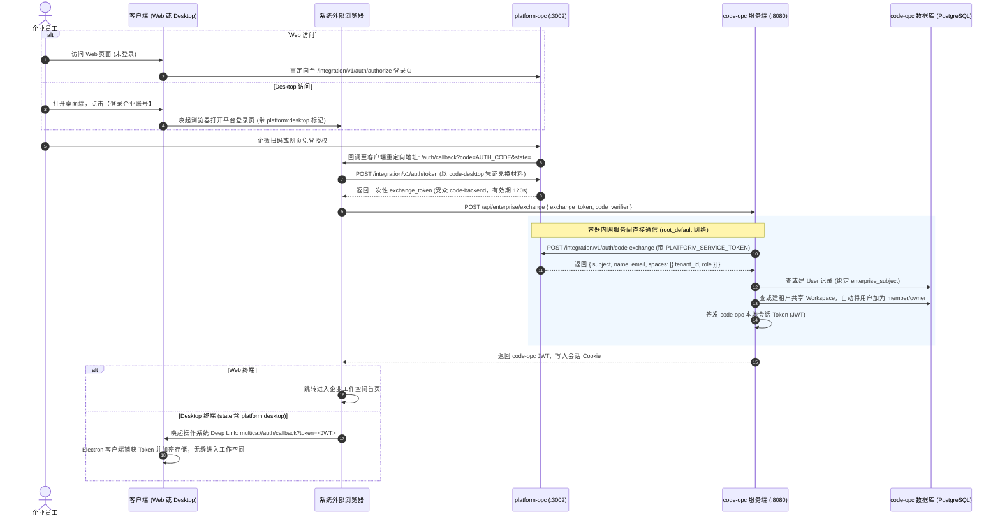

# code-opc 接入 platform-opc 企业统一登录设计规范

## 1. 概述与背景

本项目旨在将 `code-opc`（基于 Multica 开发的协同编码与 Agent 客户端）的身份与登录系统完全接入 `platform-opc`（TokenDance 统一网关），实现企业级单点登录（SSO）与工作空间即时预配（JIT）。

### 核心设计约束
1. **绝对隔离 `knowledge`**：
   - 改造过程中**不得接触、修改或调用 `knowledge`（WeKnora）的任何接口、数据库或代码**。
   - `code-opc` 作为纯客户端，只与 `platform-opc` 现有的客户端接口组（`/integration/v1`）进行通信。
2. **独占企业单点登录 (Exclusive SSO)**：
   - 完全屏蔽原生邮箱验证码、密码登录与自主注册表单，统一使用 `platform-opc` 企微企业登录入口。
3. **多终端全量覆盖**：
   - **Web 端**：直接在浏览器完成重定向与 Cookie 写入，无缝进入工作区。
   - **Desktop 桌面端**：点击登录唤起系统默认浏览器扫码授权，通过操作系统的自定义协议 Deep Link (`multica://auth/callback?token=<JWT>`) 无感回传凭据。
4. **企业租户工作空间 JIT 协同 (Tenant Workspace JIT)**：
   - 依据 `platform-opc` 返回的用户所属企业/租户（`tenant_id`），自动创建并加入共享工作区，实现同组织员工免邀请协同。

---

## 2. 交互时序与架构

整个认证链路完全在 `code-opc` 与 `platform-opc` 之间完成（容器网桥 `root_default` 内网直通）：



---

## 3. 详细设计规范

### 3.1 `platform-opc` 契约复用（零新增接口）
直接复用 `platform-opc` 现存的客户端标准集成接口：
* **`POST /integration/v1/auth/authorize`**：
  - 入参：`client_id="code-desktop"`, `redirect_uri="http://.../auth/callback"`, `code_challenge`, `state`。
  - 出参：`authorize_url`, `login_txn_id`。
* **`POST /integration/v1/auth/token`**：
  - 入参：`grant_type="authorization_code"`, `code`, `code_verifier`, `client_id="code-desktop"`。
  - 出参：`exchange_token`（专为 `code-backend` 签发，不包含平台长效 Access Token，最小权限）。
* **`POST /integration/v1/auth/code-exchange`**：
  - 认证：`Authorization: Bearer <PLATFORM_SERVICE_TOKEN>`（由 `code-opc` 服务端持有）。
  - 入参：`{ "exchange_token": "...", "code_verifier": "..." }`。
  - 出参：原子消费 `exchange_token`，返回用户的不可变主体、姓名、邮箱和所属租户空间列表 `spaces`。

### 3.2 `code-opc` 服务端改造 (`server/`)
1. **配置集成** (`server/internal/platform/client.go` & `server/cmd/server/config.go`)：
   - `PLATFORM_BASE_URL`：平台网关内网地址，默认 `http://weknora-gateway:3002`。
   - `PLATFORM_SERVICE_TOKEN`：与平台共享的 system_admin 凭据（禁止硬编码，由环境变量注入）。
   - `ENTERPRISE_SSO_ONLY`：开关变量，缺省 `true`。
2. **登录换票路由** (`server/cmd/server/router.go` & `server/internal/handler/enterprise.go`)：
   - 挂载公开路由：`POST /api/enterprise/begin` 与 `POST /api/enterprise/exchange`。
   - `POST /api/enterprise/exchange`：
     - 校验 `exchange_token` 与 `code_verifier`；
     - 调用 `platformClient.CodeExchange` 获取用户画像；
     - 执行 JIT 空间分配逻辑；
     - 签发本地 Session JWT 写入 Cookie 并返回响应。
3. **公开配置下发** (`server/internal/handler/config.go`)：
   - 在 `GET /api/config` 响应中输出：
     ```json
     {
       "enterprise_sso_only": true,
       "platform_client_id": "code-desktop",
       "platform_auth_url": "https://shtokendance.benlai.com"
     }
     ```

### 3.3 数据库模型与 JIT 协同预配 (`server/pkg/db/`)
1. **用户身份绑定**：
   - 在 `users` 表确立 `enterprise_subject`（唯一索引）及 `email` 映射；
   - 首次登录自动创建用户，同步 `display_name` 与 `avatar`。
2. **租户共享工作空间 (Workspace JIT)**：
   - 取用户在 `platform-opc` 的首选/主空间 `tenant_id`；
   - 生成固定 slug：`tenant-<tenant_id>`；
   - 若不存在该 Workspace：新建工作空间（命名为 `企业协同空间 (<tenant_id>)`），并将该用户设为 `owner`；
   - 若已存在该 Workspace：检查 `workspace_members`，未加入则插入成员记录（role: `member`）。

### 3.4 前端与桌面客户端改造 (`apps/web/`, `apps/desktop/`, `packages/views/`)
1. **独占单点登录界面** (`packages/views/auth/login-page.tsx`)：
   - 当 `enterprise_sso_only` 为 true 时：
     - 隐藏邮箱验证码、密码输入框与注册链接；
     - 仅保留企业 Logo 与【使用企业账号登录（企微扫码 / 免登）】主行动按钮；
     - 点击按钮生成 PKCE 密钥对（`verifier` 与 `challenge`），调用 `POST /api/enterprise/begin` 或直接前往平台 `authorize_url`。
2. **回调处理与分发** (`apps/web/app/auth/callback/page.tsx`)：
   - 捕获 URL 的 `code` 与本地存储的 `code_verifier`；
   - 向 `platform-opc` 换取 `exchange_token` 后提交给 `code-opc` 后端 `POST /api/enterprise/exchange`；
   - 成功后判断 `state`：
     - **Web 模式**：设置登录态，`router.replace('/')` 进入系统；
     - **Desktop 模式**：页面展示“登录成功”，通过 `window.location.href = multica://auth/callback?token=${token}` 唤起桌面端。
3. **桌面端监听与存储** (`apps/desktop/src/main/index.ts`)：
   - 监听 `multica://` 协议回调；
   - 捕获到 Token 后使用 Electron `safeStorage` 加密存储；
   - 通知渲染进程加载并进入工作空间。

---

## 4. 部署与环境变量规范

### `code-opc` 生产环境变量 (`server.env`)
```bash
# 平台网关服务间直连
PLATFORM_BASE_URL=http://weknora-gateway:3002
PLATFORM_SERVICE_TOKEN=3a70ecbf6b0788041c3e6ab271053f737beff4ca94211bef9d5022b77b10786d

# 单点登录配置
ENTERPRISE_SSO_ONLY=true
ALLOW_SIGNUP=false
APP_ENV=production
```

---

## 5. 验收标准与验证方案

1. **绝对隔离性校验**：
   - 审查代码与调用链路，确保全局无任何 `WeKnora` / `knowledge` 后端接口调用或数据库访问。
2. **Web 端全流程验证**：
   - 未登录访问 Web 首页，自动重定向至企业登录卡片；
   - 点击企微登录，完成扫码，正确重定向回 Web 并自动归属到企业工作空间。
3. **Desktop 端全流程验证**：
   - 打开桌面客户端，点击企业登录，唤起系统外部浏览器；
   - 扫码授权后，浏览器成功唤起 `multica://`，桌面端无感登入工作空间。
4. **多成员协同验证**：
   - 同一企微企业的第二位员工登录，验证自动加入同一个 Workspace，实现协同操作。
